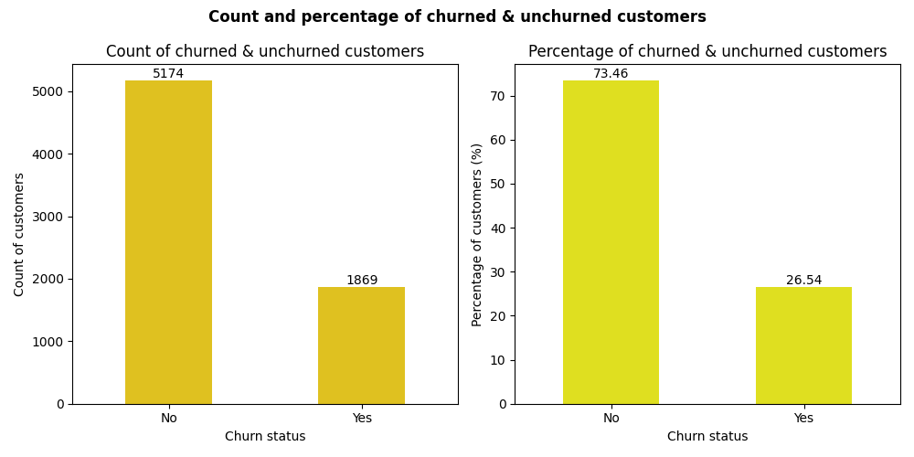
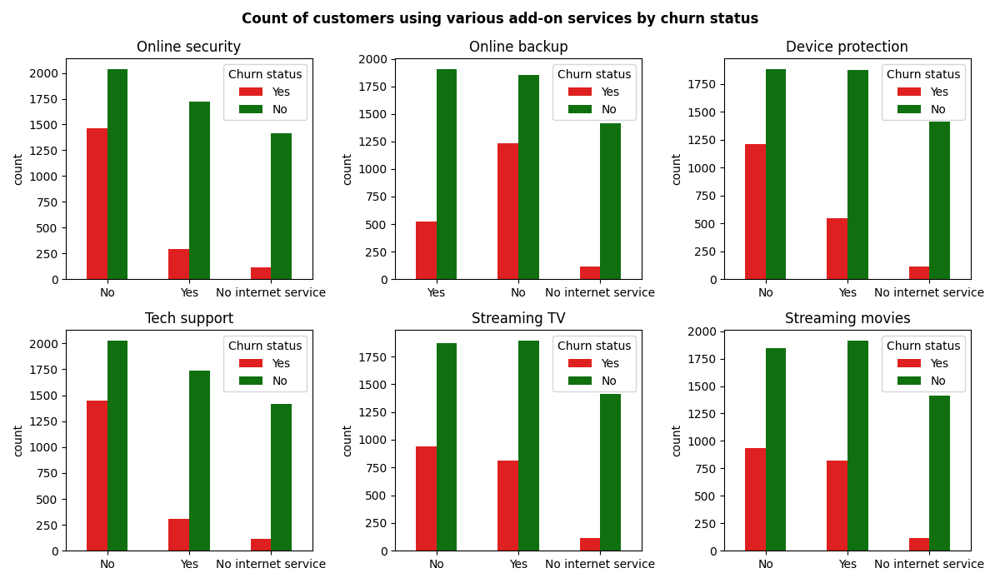
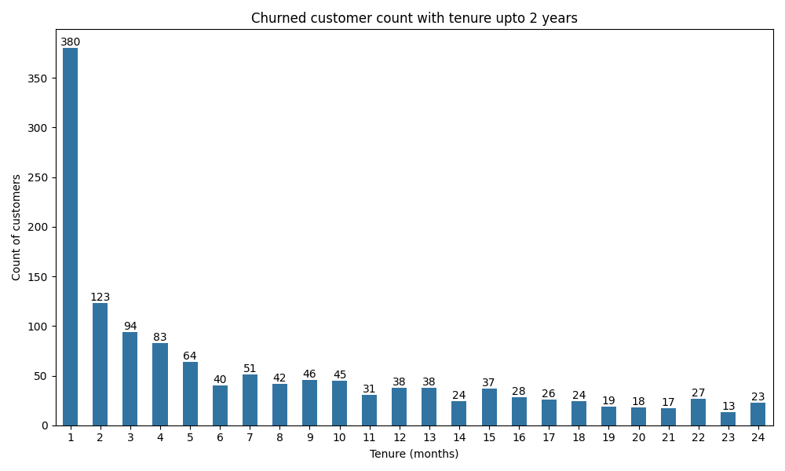
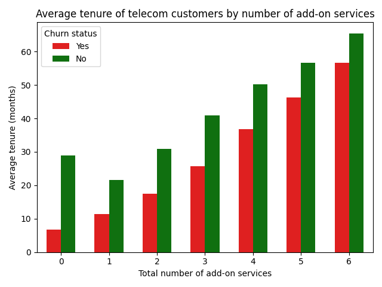
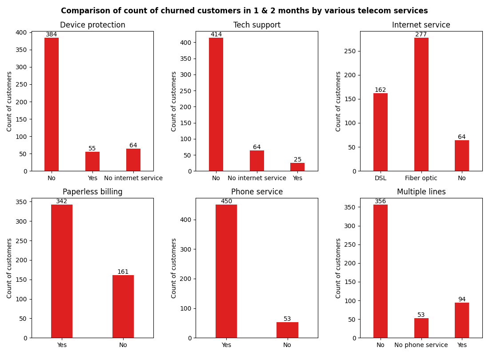

# Data Analysis of Telecom Customer Churn

  
  
  

## 📓Kaggle Notebook
https://www.kaggle.com/code/reshmaharidhas/telecom-customer-churn-analysis/notebook

## 💻Analysis Workflow
- Exploratory Data Analysis
- Data cleaning
- Exporting cleaned dataset
- Data visualization
- Key insights
- Business Recommendations

## 💻Tech Stack
- Python
- SQL
- Pandas
- Numpy
- Matplotlib
- Seaborn
- Plotly

## 📊Visualizations
### Kaggle Notebook visualizations

## 🗂️Dataset
- Source: Kaggle
- Dataset url: https://www.kaggle.com/datasets/alipakzad/telecom-customer-churn
- Size: 7043 rows

## 💻License
MIT
